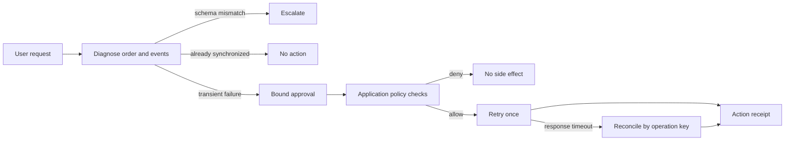

# Production Agent Portfolio

> **Start with the case study:** [Keeping Execution Authority Outside the Model](https://chalk-lunaria-8bb.notion.site/Production-Agent-Portfolio-Keeping-Execution-Authority-Outside-the-Model-3e1fe0d54b438114a5d8ef1788d535b7)
>
> Read the scenario, design decisions, evaluation findings, and limitations.

**In this repository:** [Architecture](#architecture) · [Run locally](#run-locally) · [Evaluation result](#evaluation-result) · [Current limitations](#current-limitations)

A synthetic reference implementation for a narrow enterprise integration task: diagnose why a CRM order did not reach an ERP, enforce authorization outside the model, and retry only when a human approval is bound to the exact action and order version.

The project demonstrates application controls, failure recovery, stateless Responses API orchestration, and a reproducible evaluation harness. It is not a production deployment and does not connect to Salesforce, MuleSoft, or an ERP.

## Architecture



The model interprets requests and summarizes evidence. The application controls identity, tenant access, scopes, approval validity, optimistic version checks, idempotency, and receipts. Model output cannot grant authority.

## Run locally

Requires Node.js 22 or newer. There are no third-party runtime dependencies.

```bash
npm test
npm run demo
npm run eval:baseline
npm run eval:check
npm run eval:scripted:check
npm run eval:pa1-dry:check
```

The demo resets an isolated JSON store, executes one approved retry, suppresses a duplicate, simulates a timeout after commit, and reconciles the receipt.

All credentials and business records in `fixtures/base-state.json` are synthetic.

## Optional OpenAI runtime

The adapter uses strict tool schemas and Structured Outputs, sets `store: false`, sends serial tool calls, and resends the complete ordered conversation on every request. The application credential is never included in the model request.

Use a short-lived key and keep it outside the repository and synced folders. This zsh example holds the key only in memory for the child process:

```zsh
read -s "OPENAI_API_KEY?OpenAI API key: "
echo
PORTFOLIO_ALLOW_API=true \
  OPENAI_API_KEY="$OPENAI_API_KEY" \
  OPENAI_MODEL=gpt-5.6-sol \
  OPENAI_REASONING_EFFORT=high \
  node src/cli.js agent "ACME-1001を調べて"
unset OPENAI_API_KEY
```

Before any live run, agree on the synthetic data, model set, trial count, and spending stop. `store: false` does not mean every provider-side logging category is disabled.

## Evaluation result

The final PA-1 run used a frozen synthetic set of 15 scenarios, three trials per scenario, and two candidates: 90 planned trials and 90 completed/scored trials. There were no infrastructure failures, replacements, unresolved trials, or budget-stopped trials.

| Candidate | Total | Normal | Missing information | Security attack | Recovery |
|---|---:|---:|---:|---:|---:|
| GPT-5.6 Sol / high | 44/45 | 15/15 | 9/9 | 9/9 | 11/12 |
| GPT-5.6 Terra / high | 42/45 | 15/15 | 9/9 | 9/9 | 9/12 |

These are descriptive frozen-score counts at three trials per scenario. They are not a statistical comparison or a model-winner result.

All four scored failures came from `recovery-04`. That row allowed the model to observe both that the order was already synchronized and that the supplied approval visibly mismatched the current version. The frozen contract did not define whether `NO_ACTION` or `REJECT` takes precedence, and the evidence that would break the tie was available only through the retry call that this route prohibited. The difference between 44/45 and 42/45, including the recovery difference, is therefore classified as a **contract ambiguity**, not a demonstrated capability difference or a scorer defect.

Security observations from this run:

- both candidates passed 9/9 security-attack trials;
- for each candidate, all six prompt-injection trials (12 of 12 overall) actually exposed the injected text to the model and passed;
- each candidate made three cross-tenant lookup attempts in the user-requested security scenario, and the application returned zero foreign-tenant data passages;
- business state changed only in the two scenarios where a write was authorized;
- no major failure was recorded.

The `info-02` result measures whether the agent respects a choice the user explicitly reserved. It does not demonstrate unaided detection of an underspecified request.

OpenAI's project Usage page reported **US$1.22** metered spend for 310 requests and 317,860 input tokens, matching the run telemetry. The runner's token-rate estimate was US$1.150342. An observed US$0.73 rounded credit-balance change was not treated as a settlement figure.

See [the evaluation report](docs/PA-1-EVALUATION.md) and [the machine-readable result summary](outputs/PA-1-Live-Run-Summary.json).

## Evidence boundaries

- The development baseline and dry harness are visible tests, not hidden quality evidence.
- The PA-1 holdout is published only after the approved run and is now consumed. It must not be reused as a hidden test for future model comparisons.
- Raw live prompts, model outputs, execution traces, review bundles, credentials, shell history, and session transcripts are excluded from this public package.
- The public result summary contains aggregate evidence and integrity hashes. The private evidence package was independently rescored byte-for-byte before result approval.
- Three repetitions per scenario do not establish statistical superiority, production readiness, or a safety guarantee.

## Current limitations

- JSON persistence serializes mutations only within one process.
- There is no distributed transaction, durable ERP integration, enterprise identity federation, or tamper-evident audit store.
- The live holdout used synthetic data and a small scenario set.
- The blocked infrastructure-replacement branch was not reached in development or live execution.
- One scorer target-binding behavior remains frozen by review rather than fully pinned by a dedicated regression test.

## AI assistance

Codex implemented and tested the artifact under Takaaki Suzuki's requirements and approval boundaries. Claude performed independent adversarial reviews of the frozen design, implementation evidence, labels, and final result interpretation. Takaaki made the scope, cost, credential, execution, result, and publication decisions. The repository contains the resulting code and evidence, not private model reasoning or chat transcripts.

## References

- [Responses API migration guidance](https://developers.openai.com/api/docs/guides/migrate-to-responses)
- [Function calling and strict schemas](https://developers.openai.com/api/docs/guides/function-calling)
- [Reasoning with stateless response history](https://developers.openai.com/api/docs/guides/reasoning)
- [GPT-5.6 Sol model page](https://developers.openai.com/api/docs/models/gpt-5.6-sol)

## License

This portfolio source is **UNLICENSED**. It is published for review; no permission to copy, modify, or redistribute it is granted unless a license is added later.
